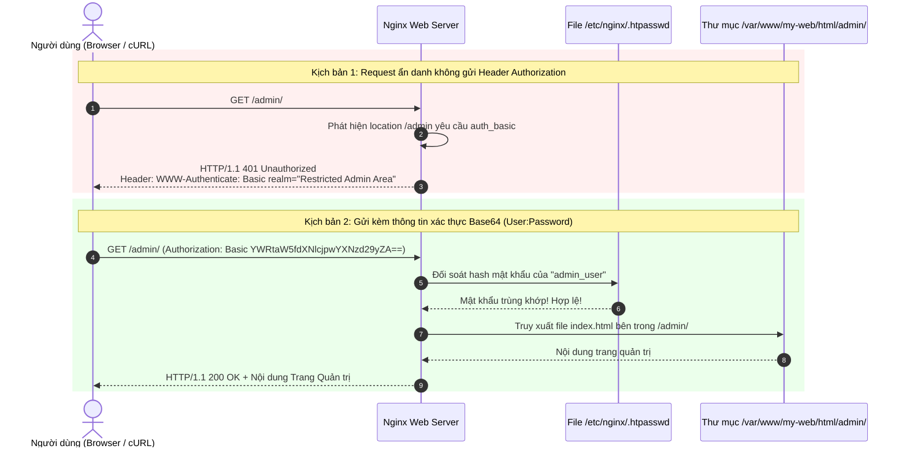

# BÀI TẬP 3: BẢO MẬT TÀI NGUYÊN BẰNG HTTP BASIC AUTHENTICATION

**Mã bài tập:** SESSION 03 - EXERCISE 3 (ss03-ex3)  
**Môn học:** IT215 - Cloud Infrastructure & DevOps Fundamentals  
**Web Server:** Nginx trên Ubuntu Server 24.04 LTS  
**Thư mục bảo vệ:** `/admin` (hoặc `/var/www/my-web/html/admin/`)  
**Tệp chứng thực:** `/etc/nginx/.htpasswd`  
**Tài khoản quản trị:** `admin_user`  

---

## 1. MỤC TIÊU BÀI TẬP

1. **Bảo vệ Vùng Tài nguyên Nhạy cảm (Access Control):** Thiết lập rào chắn bảo mật yêu cầu xác thực người dùng trước khi được phép tiếp cận trang quản trị nội bộ `/admin`.
2. **Cơ chế HTTP Basic Authentication:** Ứng dụng giao thức xác thực chuẩn HTTP chuẩn mực: Khi chưa có thông tin đăng nhập, Web Server trả về mã lỗi `401 Unauthorized` kèm header `WWW-Authenticate: Basic realm=...` để trình duyệt kích hoạt hộp thoại đăng nhập.
3. **Quản lý Mật khẩu An toàn (Secure Credential Storage):** Sử dụng tiện ích `htpasswd` từ bộ công cụ `apache2-utils` để băm mật khẩu (mã hóa chuẩn `apr1` / `bcrypt`). Đặt file ẩn `.htpasswd` bên ngoài thư mục chứa mã nguồn tĩnh (`/etc/nginx/.htpasswd`) nhằm triệt tiêu nguy cơ rò rỉ file mật khẩu ra Internet.

---

## 2. BẢNG TỔNG HỢP KIỂM TRA & KẾT QUẢ MONG ĐỢI

| Kịch bản kiểm tra | Câu lệnh kiểm tra | HTTP Status Code | Phản hồi của Web Server |
| :--- | :--- | :--- | :--- |
| **Truy cập không cung cấp tài khoản** | `curl -I http://<IP>/admin/` | **`HTTP/1.1 401 Unauthorized`** | Kèm header: `WWW-Authenticate: Basic realm="..."` |
| **Truy cập sai mật khẩu** | `curl -I -u admin_user:wrongpass http://<IP>/admin/` | **`HTTP/1.1 401 Unauthorized`** | Từ chối truy cập |
| **Truy cập đúng tài khoản & mật khẩu** | `curl -I -u admin_user:<PASSWORD> http://<IP>/admin/` | **`HTTP/1.1 200 OK`** | Xác thực thành công, trả về trang quản trị |

---

## 3. MÔ HÌNH HOẠT ĐỘNG HTTP BASIC AUTHENTICATION



---

## 4. CHI TIẾT CÁC BƯỚC THỰC HIỆN TRÊN MÁY CHỦ

### Bước 1: Cài đặt công cụ `apache2-utils`
Cài đặt gói công cụ chứa tiện ích `htpasswd` để sinh mã băm mật khẩu an toàn:
```bash
sudo apt update
sudo apt install apache2-utils -y
```

### Bước 2: Tạo tệp mật khẩu ẩn `.htpasswd` và người dùng `admin_user`
Sử dụng cờ `-c` để tạo mới file `.htpasswd` tại đường dẫn an toàn `/etc/nginx/`:
```bash
sudo htpasswd -c /etc/nginx/.htpasswd admin_user
```
*Hệ thống sẽ yêu cầu nhập mật khẩu 2 lần (ví dụ: `Admin@123456`).*

Kiểm tra nội dung tệp băm mật khẩu vừa tạo:
```bash
cat /etc/nginx/.htpasswd
# Kết quả mẫu:
# admin_user:$apr1$cI5yqC1j$n29eZom9i7hTz1zLqJ06y/
```

Thiết lập phân quyền bảo mật cho tệp `.htpasswd`:
```bash
sudo chown www-data:www-data /etc/nginx/.htpasswd
sudo chmod 640 /etc/nginx/.htpasswd
```

---

### Bước 3: Tạo thư mục nội bộ `/admin` và trang chào mừng
```bash
sudo mkdir -p /var/www/my-web/html/admin
sudo nano /var/www/my-web/html/admin/index.html
```
Thêm nội dung đơn giản:
```html
<!DOCTYPE html>
<html>
<head><title>Admin Area</title></head>
<body>
    <h1>Khu vực Quản trị - Xác thực Thành công!</h1>
    <p>Chào mừng admin_user.</p>
</body>
</html>
```
Phân quyền thư mục:
```bash
sudo chown -R www-data:www-data /var/www/my-web/html/admin
```

---

### Bước 4: Cấu hình block `location /admin` trong Nginx Server Block
Mở file cấu hình Server Block (ví dụ: `/etc/nginx/sites-available/my-web`):
```bash
sudo nano /etc/nginx/sites-available/my-web
```

Thêm khối `location /admin`:
```nginx
server {
    listen 80;
    listen [::]:80;

    server_name _;

    root /var/www/my-web/html;
    index index.html index.htm;

    location / {
        try_files $uri $uri/ =404;
    }

    # Cấu hình Basic Authentication cho khu vực quản trị
    location /admin {
        auth_basic "Restricted Admin Area";
        auth_basic_user_file /etc/nginx/.htpasswd;
        try_files $uri $uri/ =404;
    }
}
```

Kiểm tra cú pháp và tải lại cấu hình Nginx:
```bash
sudo nginx -t
sudo systemctl reload nginx
```

---

## 5. KIỂM TRA VÀ KẾT QUẢ XÁC MINH

### Kiểm tra 1: Gửi Request thông thường (Chưa đăng nhập)
```bash
curl -I http://localhost/admin/
```
* **Kết quả:**
```text
HTTP/1.1 401 Unauthorized
Server: nginx/1.24.0 (Ubuntu)
Date: Sun, 04 Oct 2026 12:30:10 GMT
Content-Type: text/html
Content-Length: 179
Connection: keep-alive
WWW-Authenticate: Basic realm="Restricted Admin Area"
```

---

### Kiểm tra 2: Gửi Request kèm thông tin đăng nhập đúng
```bash
curl -I -u admin_user:Admin@123456 http://localhost/admin/
```
* **Kết quả:**
```text
HTTP/1.1 200 OK
Server: nginx/1.24.0 (Ubuntu)
Date: Sun, 04 Oct 2026 12:30:15 GMT
Content-Type: text/html
Content-Length: 220
Connection: keep-alive
```

---

## 6. HÌNH ẢNH MINH CHỨNG & LOG TERMINAL

### Hình ảnh minh chứng


---

### Trích xuất Log Terminal thực tế

```text
devops@0310263186:~$ sudo apt install apache2-utils -y
devops@0310263186:~$ sudo htpasswd -c /etc/nginx/.htpasswd admin_user
New password: 
Re-type new password: 
Adding password for user admin_user

devops@0310263186:~$ cat /etc/nginx/.htpasswd
admin_user:$apr1$cI5yqC1j$n29eZom9i7hTz1zLqJ06y/

devops@0310263186:~$ sudo nginx -t
nginx: the configuration file /etc/nginx/nginx.conf syntax is ok
nginx: configuration file /etc/nginx/nginx.conf test is successful

devops@0310263186:~$ sudo systemctl reload nginx

devops@0310263186:~$ curl -I http://localhost/admin/
HTTP/1.1 401 Unauthorized
Server: nginx/1.24.0 (Ubuntu)
WWW-Authenticate: Basic realm="Restricted Admin Area"

devops@0310263186:~$ curl -I -u admin_user:Admin@123456 http://localhost/admin/
HTTP/1.1 200 OK
Server: nginx/1.24.0 (Ubuntu)
Content-Type: text/html
```
